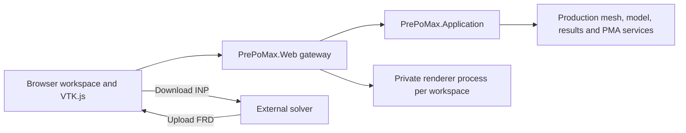

# Browser pre- and post-processing pivot

Decision: 2026-11-06. The project owner selected **browser model editing →
CalculiX input export → external solver → result upload → browser post-processing**
as the first online product workflow. Server-side solving is outside this first
release. This supersedes native GTK feature parity as the primary delivery
target; existing engineering workflows, model-tree requirements and validation
evidence still apply.

Ultimate scope clarification (2026-11-06): the target is **functional parity
with the current Prepomac checkout**, including its composites, scripting,
advanced results and custom tools. The externally solved browser workflow is
the first release, not the final feature ceiling. See the
[Prepomac parity inventory, source boundaries and acceptance criteria](PREPOMAC_WEB_PARITY.md).
The [detailed implementation roadmap](PREPOMAC_IMPLEMENTATION_ROADMAP.md) and
[test catalogue](PREPOMAC_PARITY_TESTS.md) now define the milestone order,
dependencies and source-matched acceptance gates.

M01 has started with [shared material commands](M01_MATERIAL_COMMANDS.md):
partial elastic edits, operation receipts, revision checks and retry-safe
publication through the existing snapshot history. Materials now have persistent
IDs and browser rename, including section-reference updates. Creation, solid-section
assignment and unused removal also use typed commands and receipts. The milestone remains open.

## Run the first slice

From `PERSONAL/Linux_Port_trial/VTKJS_STREAM`:

```bash
bash scripts/start-web-workspace.sh --build
```

Open **http://localhost:5180**. Subsequent launches can omit `--build` when the
sources have not changed. `PREPOMAX_WEB_PORT` selects another local port;
`PREPOMAX_DOTNET` selects the .NET executable. Build prerequisites are .NET 10
and the Node/npm versions used by the existing VTK.js client. The launcher
allows the existing .NET 8 renderer to use the installed newer Linux runtime.
Neither GTK nor ActiViz is required by this web host.

This is a **local, bounded web pilot**, not a deployed online service. It listens
only on loopback and validates the Host header. Workspaces are owned by an
opaque HttpOnly, SameSite=Strict cookie; there are no user accounts yet. A
workspace lasts eight hours, retains up to 21 project snapshots, and is deleted
on normal server shutdown. There are at most eight workspaces per process.
Download a PMA to retain work. Restarting the server starts fresh workspaces.
Crash recovery, hosted identity and durable storage remain release gates.

## Implemented browser workflow

1. Open a supported portable PMA, or import mesh-only INP, ASCII Medit MESH or
   ASCII Gmsh MSH 2.2. For a mesh, supply the initial elastic modulus and Poisson
   ratio in a consistent unit system. The production importer creates solid
   sections and a static step. Full INP analysis-deck import and arbitrary PMX
   import are not supported by this pilot.
2. Navigate the production model hierarchy. Select a region object to request
   server-resolved node highlighting within existing preview limits. The tree
   preserves the [reference hierarchy](LINUX_MODEL_TREE_TARGET.md). Inspectable
   objects without web editors are identified as such.
3. Create/edit/rename constant elastic materials, assign materials to existing
   solid sections, remove unused materials, create explicit-ID node sets, create fixed supports, create/edit
   nodal forces and add static steps. Force creation uses **force per node**.
   Existing supported surface-traction force components can also be edited.
   Domain validation comes from the existing portable services. General
   element-set/surface editing, full boundary editors, graphical set creation,
   contacts, constraints, mesh append and the remaining native editors are not
   yet exposed in the web UI.
4. Use Undo/Redo or download the current PMA. Each accepted edit changes the
   workspace revision and discards that revision's stale result payloads. Undo
   can restore a result-bearing snapshot. Concurrent stale-tab mutations fail
   with HTTP 409 and require Refresh rather than silently overwriting work.
5. Export the current CalculiX input and run the solver externally. The downloaded
   filename identifies the workspace revision. Export does not certify that
   the model is physically well posed or complete.
6. Upload the FRD for that revision under Results. Attachment checks node IDs,
   coordinates, element types and connectivity against the editable model before
   accepting a new snapshot. Incompatible/malformed uploads preserve the current
   project. Old DAT and binary result payloads are discarded on FRD replacement.
   **FRD mesh compatibility does not establish solver-input provenance**: the
   user must supply results from the current material/load/setup revision.
7. Select a static real nodal field/component/frame and displacement scale. The
   VTK.js viewport displays progressive geometry, scalar colors, the legend,
   camera views, contours and deformed geometry. The pilot does not yet expose
   DAT histories, animation, complex results or the entire renderer interaction
   surface.

Uploads are limited to 64 MiB. PMA uploads additionally allow at most 16 ZIP
entries and 128 MiB total expanded payload. Existing stricter importer and
scene limits remain authoritative: mesh inputs are at most 32 MiB, with
format-specific element/count limits. The pilot does not establish a large-model
performance qualification.

## Application boundaries



| Component | Implementation / responsibility |
| --- | --- |
| Browser application | `prototypes/VtkJsStreaming/src/client/workspace.html` and `src/workspace.ts`; separate Vite entry beside the existing embedded renderer |
| Web gateway | `portable/PrePoMax.Web`; cookie ownership, revision checks, bounded upload staging, history, streaming downloads and allowlisted renderer reads |
| Domain/application layer | Existing `portable/PrePoMax.Application` operations; `ProjectExternalResults.AttachCopy` adds validated external FRD attachment |
| Rendering | Existing production renderer and `RendererHost`; one process and result session per workspace, read-only manifest/resource gateway |
| Project representation | Existing PMA/production FeModel; no separate browser-side engineering model |

The renderer has singleton scene state **within each process**. One shared
renderer process for all web users would overwrite scenes. The pilot deliberately
owns one private process per active rendering workspace. Renderer host/session
credentials never reach the browser. The gateway exposes only current-workspace
manifest and resource reads; it does not proxy host-control APIs, session creation
or arbitrary renderer commands. Browser mutations require a custom header and
same-origin requests. Requests are serialized within a workspace, including
streamed resource reads, while different workspaces have independent locks.

PMA snapshots currently use a private temporary directory per workspace. Reads
and edits continue to reopen/validate archives; this is an intentionally bounded
first slice, not a claim of efficient large-project multi-user operation. Result
catalog inspection still uses `ProjectResults.List`; the renderer uses the
existing retained/indexed session for publication. Avoid inferring cross-request
cache efficiency or a memory quota from those APIs.

## Next delivery gates

| Milestones | Deliverable | Acceptance |
| --- | --- | --- |
| M00–M01 | Reference baseline, shared commands and project preservation | Matched fixtures/assertions; lossless edits/reopen and explicit unsupported-content refusal |
| M02 | Hosted ownership, persistence and resource isolation | Durable owned projects/artifacts, atomic restart recovery, access controls, quotas and cleanup |
| M03–M05 | Priority browser authoring workflow | Tree/selection, mesh append and full region lifecycle, static sections/supports/loads/constraints/contacts and outputs |
| M06 + M02 | First hosted external-solver release | Input/handoff comparison, external solve, validated FRD/DAT and core fields/histories, save/restart/reopen; HTTPS and owned renderer gateway |
| M07–M09 | Engineering breadth | Geometry/meshers, broader definitions/analyses/solver adapters and advanced results/histories |
| M10–M13 | Prepomac advanced/custom workflows | Composites, SRSuntour, pressure springs, individual colors, fatigue and complete Python/journal/automation semantics |
| M14 | Qualified Prepomac parity | Full source-matched workflow accounting, numerical/file/visual evidence, supported browser/GPU/performance and production recovery qualification |

Use the [roadmap](PREPOMAC_IMPLEMENTATION_ROADMAP.md) for work packages and
case-specific prerequisites. The table summarizes gates; it does not mark
existing portable/GTK or pilot behavior as completed web parity.

Native packaging and desktop-only polish no longer lead the product roadmap.
Keep GTK/CLI as reference clients and preserve existing physical-GPU and visual
acceptance gates. No server-side solver execution, arbitrary script execution,
collaborative editing, billing or public deployment is introduced by this slice.

## Validation

```bash
# Build before HTTP/browser checks:
bash scripts/start-web-workspace.sh --build
# Stop the interactive server when done; these checks own their own server:
python3 scripts/test-web-workspace.py
(cd prototypes/VtkJsStreaming/src/client && npm test && npm run test:web)
(cd portable && dotnet run --project tests/MeshIO.Characterization -c Release)
```

The HTTP acceptance uses the real web host and two independent production
renderer processes. It covers cookie ownership, same-origin mutation checks,
mesh import, tree/edits/export, failed-edit preservation, revision conflicts,
undo/redo, compatible/incompatible FRD, resource hashes, result invalidation
and workspace isolation. Browser acceptance exercises actual upload forms,
material editing, solver-input download, FRD selection/deformation, camera/scalar-color
controls and narrow-screen overflow. Headless Chromium uses software WebGL and
does not qualify physical GPU performance.

Validation completed on 2026-11-06: the web host builds, the client TypeScript/
production build passes, all 98 existing client unit tests pass, all 2,892
mesh/project characterization checks pass, the HTTP acceptance passes, and
the Chromium browser workflow passes. The browser check also verifies no
uncaught page errors and no horizontal overflow at a 390-pixel viewport.
