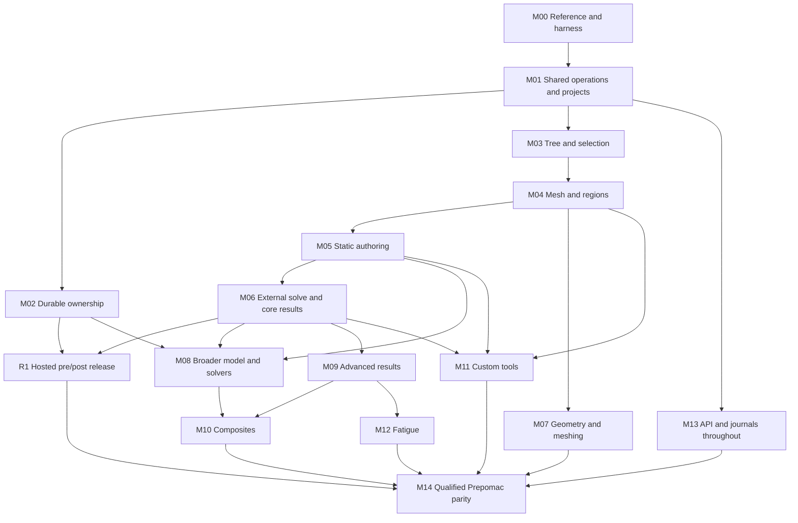

# Prepomac browser implementation roadmap

Version 1 — 2026-11-06; updated 2026-11-09. This is the implementation order and acceptance contract
for the [Prepomac functional parity target](PREPOMAC_WEB_PARITY.md). The current
working tree at the repository root, including its custom additions, is the
reference. The [local web pilot](ONLINE_PRE_POST.md) is an existing subset, not
evidence that a parity milestone below is complete.

The [test catalogue](PREPOMAC_PARITY_TESTS.md) defines **52 acceptance
cases**. Its source of truth is [the machine-readable plan](parity/plan.json),
which maps **74 desktop API scripts / 77 declared runs**, **3 offline checks**
and **15 custom verification scripts** to cases, with additional portable and
renderer references. These counts are inventory results, not tests passed.
No reference application, solver or GPU suite was run to create this roadmap.

Execution update (2026-11-06): M00 now has an
[executable harness](PARITY_HARNESS.md) and
[recorded baseline/comparison evidence](evidence/M00-2026-11-06/REPORT.md).
Use the generated catalogue and evidence summary for current outcomes; the
initial planning counts above are not runtime pass claims.

## Delivery order

| Milestone | Deliverable | Prerequisites | Acceptance cases |
| --- | --- | --- | --- |
| M00 | Freeze the reference and build the comparison harness | None | M00-T01–T02 |
| M01 | Shared operations, command identity and lossless project contracts | M00 | M01-T01–T03 |
| M02 | Durable owned workspaces and managed artifacts | M01 | M02-T01–T03 |
| M03 | Model tree, viewport selection and navigation | M01 | M03-T01–T03 |
| M04 | Mesh import/append, region lifecycle and mesh maintenance | M03 | M04-T01–T04 |
| M05 | Complete static-solid authoring | M04 | M05-T01–T04 |
| M06 | External-solver handoff and core post-processing | M05; M02 for release | M06-T01–T04 |
| M07 | Geometry operations and supported meshers | M04 | M07-T01–T04 |
| M08 | Broader definitions, analysis types and solver adapters | M02, M05, M06 | M08-T01–T04 |
| M09 | Advanced fields, histories and presentation | M06 | M09-T01–T03 |
| M10 | Composite modeler and composite results | M08, M09; M07 for CAD mapping | M10-T01–T04 |
| M11 | SRSuntour, pressure springs and custom result tools | M04, M05, M06; M07 for sweep/chamfer qualification | M11-T01–T05 |
| M12 | Fatigue setup, packages and numerical behavior | M09 | M12-T01–T03 |
| M13 | Complete Python/API, journals and automation | Starts at M01; full cases require the domain milestones they exercise | M13-T01–T03 |
| M14 | Whole-project parity, performance and production qualification | M02, M07–M13 | M14-T01–T03 |

Numbers give a default implementation sequence; the dependency graph determines
what can proceed independently. For example, geometry and advanced result work
can proceed after their own prerequisites without waiting for one another.
M13's command/replay foundations start early; final API parity cannot pass while
the model/result/custom operations it exposes are still missing. Case-specific
dependencies in the registry also apply when completing a milestone.



The graph is a readable summary; the registry is authoritative for all direct
and case-specific dependencies.

## Releases and boundaries

**R0 — existing local pilot:** bounded PMA/mesh import, limited authoring,
snapshot undo/redo, input download, FRD attachment and scalar/deformation display.
Retain its existing HTTP/Chromium tests as regressions. Temporary workspaces and
loopback hosting are not an online release.

**R1 — hosted static-solid pre/post:** complete M00–M06. Users can own durable
projects, import/append meshes, select and maintain regions, author the agreed
static-solid definitions, export solver input, solve externally, upload results,
inspect fields/raw histories, save, restart and resume. Constraint/contact and
remaining subtype coverage must be stated explicitly; no full-script pass may
be claimed from running just its supported subset.

**R2 — engineering breadth:** M07–M09 add geometry/meshing, broader material and
analysis definitions, advanced result operations and later controlled solver
execution. Native meshing needs a managed job boundary even though R1 solving
remains external. Preserve external handoff as a supported workflow.

**R3 — qualified Prepomac parity:** M10–M14 complete composites, custom tools,
fatigue, automation and whole-project qualification. Missing reference fixtures,
unavailable tools/hardware and known desktop failures remain visible gaps.
Do not label the whole application equivalent while required cases are open.

No calendar dates or duration estimates are assigned yet. M00 establishes the
actual source delta, reference failures and environment requirements needed to
estimate work. Move order only for a documented dependency or representative
project need, and update the registry and affected acceptance gates together.

## Milestone work packages

### M00 — Reference baseline and comparison harness

**Reference update 2026-11-09:** M00 is reopened for three new desktop verifiers
(virtual friction, automatic pressure weighting and native dialog resizing).
The completed November 6 capture/outcomes remain historical evidence. Current
sources/runtime have a new immutable capture; those three verifier runs remain pending.

1. Capture the current root working tree: revision, dirty/untracked file list,
   content hashes, build inputs, binaries, fixtures and tool versions. Include
   local composite/custom features; the Linux trial snapshot is not the oracle.
2. Collect tests through Prepomac's existing `Run_Tests.py` header parser. Keep
   all declared invocations, expected exits/reports and generated-result
   prerequisites. Capture a baseline run; classify existing failures separately.
3. Establish read-only semantic exporters for document/model/mesh/results and
   two drivers: Prepomac and web/application. Start with one property, one sparse
   selection and one fixed FRD field. Preserve original assertions and tolerances.
4. Check in redistributable small fixtures and manifests. Generate private/model
   copies only with consent; large user models supplement small deterministic
   fixtures rather than making the suite depend on a private path.

**Gate:** M00-T01–T02; deliberately corrupted comparison outputs must fail.
Source/test hashes alone do not complete the full production baseline.

### M01 — Shared operations, command identity and project contracts

**Execution:** the [first material-command slice](M01_MATERIAL_COMMANDS.md) is
implemented and [qualified against Prepomac](evidence/M01-material-2026-11-06/REPORT.md).
The [material identity/rename slice](evidence/M01-identity-2026-11-09/REPORT.md)
adds PMA identity persistence and records a desktop section-reference defect.
The [material lifecycle slice](evidence/M01-lifecycle-2026-11-09/REPORT.md) adds
typed creation, solid-section assignment and unused removal with exact bounded
reference comparisons.
M01-T01/T03 remain in progress; M01-T02 and the remaining contracts below are open.

1. Map root Prepomac sources against the trial's selected source lists. Extract
   or link UI-independent domain operations incrementally; put UI/native tool
   concerns behind host interfaces. Preserve current desktop builds/tests.
2. Give mutation requests an operation ID, expected revision and typed command.
   Apply validation, reference changes and publication through a common operation
   path. Keep stable object identity independent of display names.
3. Define a versioned project representation that preserves each supported
   definition and its referenced artifacts. Implement atomic save/reopen,
   upgrade and explicit capability refusal before broader editors are enabled.
4. Qualify PMX interoperability/protection/older command layouts separately from
   PMA semantics. Put legacy conversion behind a bounded conversion boundary;
   importing a project must not execute arbitrary serialized/script content.
5. Establish command history and script-failure semantics now. Snapshot undo is
   a temporary storage mechanism, not a substitute for regeneration/journals.

**Gate:** M01-T01–T03. An unrelated edit must preserve advanced/custom content
or fail before publication. No silent dropping of unknown definitions.

### M02 — Durable ownership and managed artifacts

1. Replace temporary cookie-only storage with authenticated project ownership,
   durable revisions, artifact metadata and explicit retention/deletion rules.
2. Store geometry, distributions, material libraries, FRD/DAT and tool inputs by
   managed artifact identity/hash. Remove dependence on desktop absolute paths.
3. Make publication atomic and retries/reconnects explicit. Recover the last
   committed revision after restart/interruption, including result association.
4. Enforce ownership on every API/download/resource/job; preserve renderer
   isolation. Add admission, upload/expansion, process/memory/disk and cancellation
   boundaries before exposing native tool execution or online hosting.

**Gate:** M02-T01–T03: two owners, stale tabs, restart, interrupted publication,
cross-owner access, oversize/expanded inputs, capacity exhaustion and cleanup.
These online cases supplement Prepomac tests; they have no desktop equivalent.

### M03 — Tree, selection and navigation

1. Preserve the required Model hierarchy and stable object keys. Connect real
   object actions, selected-object editors, visibility/activation and inspectable
   unsupported definitions. Add Geometry/Results contexts as their services land.
2. Connect browser picking/rectangles/angle selection to server-validated source
   IDs. Implement the same node/element/face/edge/part selection algebra and
   selection history as Prepomac; saved membership must not be sampled previews.
3. Preserve tree expansion/selection across updates and test actual browser
   pointer capture, release outside the viewport, supported navigation modes,
   camera/projection and context-menu behavior.

**Gate:** M03-T01–T03. Equal labels in different steps and large/sparse IDs must
not select the wrong object. Test IDs and camera behavior, not screenshots alone.

### M04 — Mesh integration, region lifecycle and maintenance

1. Extend import formats/element families by reference fixtures. Treat mesh-only
   and full analysis-deck import as different capabilities.
2. Add mesh to the existing model with explicit collision/remapping rules for
   nodes, elements, parts, sets, surfaces and all dependent references. Preserve
   source IDs when possible and never weld coincident nodes implicitly.
3. Complete node-set/element-set/surface create/replace/membership/rename/
   duplicate/remove through the tree and selection tools. Preserve backing-set
   ownership and face labels; update all typed references.
4. Add reference points, coordinate systems, mesh transforms/copies, quality
   diagnostics and command-backed removal of bad elements with undo/redo.

**Gate:** M04-T01–T04. Use deliberate ID/name collisions and referenced regions;
compare membership/connectivity before and after save/reopen and failed append.

### M05 — Complete static-solid authoring

1. Complete materials needed by static-solid fixtures, solid-section lifecycle,
   assignment precedence and coverage. Keep equations and table order intact.
2. Expose static step settings/lifecycle; all agreed static supports and
   mechanical loads; copy/propagation and active/inactive behavior. Keep force
   per node distinct from total surface force.
3. Add ordinary springs, ties, rigid bodies and contact interactions/pairs with
   reference-point/master/slave/region validation. Pressure-dependent springs
   wait for result-artifact handling in M11.
4. Expose static field/history requests, parameters and keyword insertion with
   supported remapping. Preserve imported definitions while editing unrelated
   ones. Record non-static branches for M08 rather than weakening their tests.

**Gate:** M05-T01–T04. Compare domain snapshots and normalized solver keywords;
browser tests author a section, support/load, constraint and contact on created
regions, then save/reopen and repeat the export comparison.

### M06 — External solve and core post-processing

1. Export an immutable revision/input/artifact manifest and a portable handoff.
   Retain input hashes, units and solver settings so returned artifacts can be
   associated with a claimed run without pretending FRD proves provenance.
2. Import FRD/DAT and support standalone result inspection. Match mesh, field/
   component/frame/time/unit catalogs, physical values and result replacement/
   invalidation semantics; preserve failed-import state.
3. Complete scalar/deformation/legend/query behavior and raw history catalog,
   aligned tables, plotting data and CSV export. Advanced histories stay in M09.
4. Exercise both the reference-authored and browser-authored deck through the
   same externally invoked solver and compare them with the source assertions.

**Gate:** M06-T01–T04 plus M02. The first hosted release must survive save,
restart and reopen. Keep the analytic cube fixture distinct from Prepomac's
`Test_Analysis.py` model; their loads/materials are not interchangeable.

### M07 — Geometry and meshing

1. Port geometry import/metadata/measurements, transforms and assembly exports.
2. Port source-defined split/fuse/group/periodic/offset/delete/defeature/repair
   operations and preserve topology/selection identity or explicitly invalidate
   selections when the topology changes.
3. Add mesher settings/lifecycle, source-supported solid/shell families and
   native meshing jobs. Include sweep/revolve, compound cells, transfinite faces,
   prisms and shared mapping behavior across the supported meshers.
4. Reproduce geometry-to-mesh-to-model/export/external-solve/results/reopen,
   including metadata and quality/negative-case behavior.

**Gate:** M07-T01–T04. Use exact topology only where the reference is deterministic;
otherwise retain its geometric/quality/boundary and numerical assertions. A
different mesher output cannot silently change existing region/selection meaning.

### M08 — Broader definitions, analysis types and solver adapters

1. Complete remaining material/section types, temperature tables, amplitudes,
   distributions, initial conditions and defined fields; retain units/equations.
2. Cover the source-defined non-static steps, controls, remaining supports/loads,
   outputs and thermal workflows. Require a numerical fixture for each claimed
   family; creation/persistence alone does not prove analysis parity.
3. Match analysis/job settings and additional solver handoffs, including the
   documented Code_Aster subset. Capture new Code_Aster differential fixtures;
   the build image is not an existing numerical test.
4. After R1, implement controlled hosted job execution if delivering Prepomac's
   run/cancel/status/open-results functions: configured capabilities, owned job
   directories, limits, progress/logs, cancellation and restart recovery. Browser
   requests do not choose arbitrary server executables.

**Gate:** M08-T01–T04. Native execution is a later acceptance target; it does not
change R1's externally solved workflow. Composite Code_Aster results also need M10.

### M09 — Advanced post-processing

1. Complete field equations, limits/envelopes, filters, complex components,
   coordinate transforms and output lifecycle/export on fixed immutable results.
2. Complete derived histories: field/equation/integration/merge/extract/XY/table,
   filters, alignment, units, dependencies and recorded command behavior.
3. Complete multiple-result lifecycle, probes/annotations/extrema, section/
   explode/transform views, animation, captures and context-loss/reconnect.

**Gate:** M09-T01–T03. Compare every numeric output and missing-value mask before
visual comparisons. Display normalization must never alter physical values.

### M10 — Composite workflows

1. Port composite section/layer/symmetry/parameter and material orientation
   behavior, including flat/inclined/cylindrical fixtures and exported axes.
2. Match ply result sets, shell/material-axis transforms, failure criteria,
   reserve factors/modes and result tree grouping with source tolerances.
3. Inventory and qualify GUI-only modeler/mapping/rosette/drape/discrete-
   orientation commands using a read-only desktop extractor. Python test
   coverage cannot prove features that have no public API.
4. Qualify the Code_Aster true-layered-shell handoff against desktop Code_Aster
   first; comparisons to CalculiX's different formulation need their own
   physically justified reference bounds.

**Gate:** M10-T01–T04. Missing GUI-only/Code_Aster fixtures are explicit work,
not exclusions silently inferred from what the API suite happens to exercise.

### M11 — Custom mechanical/result tools

1. Port cylinder lifecycle and SRSuntour extrusion/sweep/chamfer/contact update
   behavior, repeat safety and dependent assignment preservation. Include the
   four source linear/quadratic hex/wedge families and layer/axis variants.
2. Port pressure-dependent springs with managed source FRDs, projected pairing,
   source increment/side selection, four pressure laws and SPRING2 export.
3. Port per-element-set stress color limits and local extrema; preserve shared
   node/material behavior, physical values, plateau rules and saved modes.
4. Port standalone spring/result file tools and displayed-result FRD exports.
5. Port contact virtual friction, arbitrary vectors, sparse optimal pairing and
   automatic pressure weighting, including its later controlled two-pass job flow.
   These source features and three new verifiers entered the inventory after M00;
   the current-reference baseline extension is pending.

**Gate:** M11-T01–T05. Keep numerical, project/journal and GPU checks separate.
CAD-dependent sweep/chamfer branches need M07 even if simpler mesh-only branches
are ready earlier.

### M12 — Fatigue

1. Add Loads/Model/SN Curve editing, source file/generated histories,
   repetitions, result-step associations and setup persistence/cancel behavior.
2. Export relocatable fatigue packages with complete managed artifacts. Match
   CPU result fields, independent load-case accumulation and critical-plane
   selection using the reference backend's existing tests.
3. Match controlled execution/handoff, progress/cancel/import and the documented
   CUDA-unavailable CPU fallback. Qualify real CUDA/MATLAB/FATLAB separately when
   the reference runner, runtime and hardware exist.

**Gate:** M12-T01–T03. Package export is not numerical execution evidence. Preserve
the existing unqualified status of backends that lack reference execution.

### M13 — Python, journals and automation

1. Start the shared command/API validation surface with M01; incrementally run
   each feature's reference cohort as its operations become available.
2. Preserve public names, option vocabulary, argument validation, return shapes,
   equations, replacement defaults and readback; add a hosted Python adapter
   with explicit artifact/work-directory/resource boundaries.
3. Match record-and-run, command suppression, partial failure, undo branches,
   regeneration and journal replay with equivalent model/input/results. Keep
   expected nonzero exits and strict-prompt refusal as successful test outcomes.
4. Adapt RPC/MCP transports while preserving capability/read-only/ownership/
   operation semantics. Full unchanged-script parity is distinct from temporary
   HTTP semantic adapters and must be reported separately.

**Gate:** M13-T01–T03 and each case's domain dependencies. An API cannot be fully
qualified before the advanced/custom operations it exposes are implemented.

### M14 — Integrated qualification

1. Run representative whole projects across both hosts: author, save, reopen,
   export, external/native solve where claimed, inspect, export again and restore.
2. Qualify browser/platform/physical-GPU behavior, source-prescribed large-scene
   thresholds, cleanup, update/recovery and supported online network profiles.
3. Reconcile every baseline capability, declared reference run and qualification
   gap. Record evidence and supported scope for the release/source identities.

**Gate:** M14-T01–T03. Known desktop failures require diagnosis/decision; they
are not successful web tests. A release can state a bounded supported subset,
but full Prepomac parity requires closing all required gaps.

## Comparison rules and tolerances

| Output | Required comparison |
| --- | --- |
| IDs, types, memberships and references | Exact sets/sequences as appropriate, including case/namespace/ordering semantics. No sampling or lossy JSON summary as the only oracle. |
| Equations and tables | Preserve source expressions, units and table order; independently compare evaluated values where the reference does. |
| Model/persistence | Semantic identity across reopen; bytes need not match between PMA/PMX. Claimed PMX interoperability requires opening the exported PMX in Prepomac. |
| Solver input | Parse the actual keyword sequence and numeric parameters. Ignore only reviewed nonsemantic comments/timestamps and explicitly mapped artifact paths. Never sort away section precedence, step/output order or duplicate-keyword behavior. |
| Same immutable result artifact | Exact raw numeric values/missing-value masks after the same decoding; source-ID/component/frame alignment first. Derived algorithms retain their original source bounds. |
| Independently solved models | Same recorded solver/build/settings, original test tolerances and analytic checks. Do not use a global loose epsilon or relax a threshold after seeing a mismatch. |
| Different mesh/kernel versions | Keep original geometric/topological/quality/response invariants. Approved ID remapping must still preserve named-region and selection semantics; isomorphic counts alone are insufficient. |
| Visual output | Fixed model, camera, projection, units, range, palette, viewport, DPR and hardware. Prefer source pixel/geometry assertions to whole-image byte equality across renderers. Store images and numeric state together. |

Concrete source anchors include:

- Analytic cube: `U1=0.001`; `rel_tol=1e-5`, `abs_tol=1e-10` in
  `scripts/test-native-calculix.py`. This is an additional analytic check, not
  a replacement for the different `Test_Analysis.py` model.
- Pressure springs: weight comparisons `rel_tol=1e-8`, `abs_tol=1e-8` and the
  exported `K=200/600` displacement fixture `U3=0.5/1/6` in the source verifier.
- Composite laminate: source S11 bound `0.01*abs(expected)+0.05`; S22 bound
  `0.03*abs(expected)+0.05`; failure indices `<1e-4`; Tsai-Wu reserve factor
  `<1e-3*reserve`, retaining the separate principal/mode/NaN assertions.
- Fatigue: preserve each unittest's bounds, including fast/general
  `rtol=1e-9`, `atol=1e-10`; do not replace tighter per-case checks.
- Individual-color GPU fixture: source interior red/blue channel thresholds
  `>240` / `<10`, unassigned gray `abs(channel-153)<3`, plus physical scalar
  preservation and wireframe/camera buffer checks.
- Large renderer: retain the existing quantitative targets/hard failures in
  [the benchmark report](../prototypes/VtkJsStreaming/docs/benchmark-report.md)
  and [pending physical-GPU requirements](VTKJS_PENDING_WORK.md). Existing
  loopback thresholds are not silently applied to an unspecified hosted network.

## How each feature is implemented and accepted

For each small implementation slice, identify its case and the exact reference
assertions it reaches. Capture the Prepomac output first, then implement the
shared operation/persistence, HTTP contract and browser interaction. Add the
smallest browser tests that establish the task and meaningful failure behavior.
Run the affected reference/differential cohort and current portable/web
regressions. Record evidence before changing a case to passed.

When a source script covers several features, mark assertion-level coverage
explicitly. Its full declared run remains pending until all original assertions
run. A GUI driver, semantic HTTP adapter and unchanged Python script are distinct
drivers; changing the driver must not delete numerical/behavioral assertions.
Where the original test uses CLR/UI internals, extract its fixture and assertions
into a neutral check or use a read-only desktop snapshot exporter. Track the
unsupported transport-specific portion until a deliberate replacement exists.

An evidence bundle must contain case/run IDs; production/test/fixture/build
hashes; environment and commands; reference and web outcome; snapshots and diffs;
input/output artifact hashes; solver logs/results where relevant; screenshots/
camera state for visual cases; comparator/tolerance identity; and explicit
not-run/blocked reasons. Keep private data/keys/tokens out of committed artifacts.
The JSON registry records evidence paths and implementation paths per case.

## First implementation queue

1. **PR 1 — baseline manifest and oracle capture (M00-T01).** Use the existing
   collector, freeze the working-tree identity, run reference/offline cohorts and
   record environment/dependency failures. Do not modify the reference to make
   the baseline green.
2. **PR 2 — differential harness (M00-T02).** Implement model/selection/fixed-FRD
   snapshot readers and comparison reports; prove a wrong ID/value is detected.
3. **PR 3 — shared command and preservation seam (M01-T01/T03).** Route one real
   material edit through the common operation/command path; verify replacement,
   failure and unrelated-definition preservation.
4. **PR 4 — project compatibility contract (M01-T02).** Qualify small PMX/legacy/
   protected cases and explicit unsupported-content refusal; avoid a bulk source
   swap or an unverified general PMX claim.
5. **PR 5 — durable project/revision/artifact storage (M02-T01).** Recover saved
   work after restart and interrupted publication; then qualify ownership and
   quotas before external access.
6. **PR 6 onward — tree/picking, region lifecycle, append and static authoring**
   in M03 → M04 → M05 order, carrying the matching source cohort and persistence
   checks with each editor.

## Commands and ongoing tracking

From `PERSONAL/Linux_Port_trial/VTKJS_STREAM`:

```bash
python3 scripts/check-web-parity-plan.py
python3 scripts/check-web-parity-plan.py --check-source-hashes
python3 scripts/check-web-parity-plan.py --write-catalogue
```

These validate planning metadata, dependency closure and reference inventory;
they do not execute the application or prove parity. The catalogue is generated
from `docs/parity/plan.json`; edit the registry and regenerate it together.

Reference commands run from the repository root after a desktop build:

```bash
reference_offline_work="$(mktemp -d -t prepomac-reference-offline-XXXXXX)"
python3 APIs/Python/Test_Scripts/Run_Tests.py --exe macOS/PrePoMax/bin/Release/net10.0/PrePoMax.com --work "$reference_offline_work" --filter Audit_ test_runner_offline
reference_region_work="$(mktemp -d -t prepomac-reference-regions-XXXXXX)"
python3 APIs/Python/Test_Scripts/Run_Tests.py --exe macOS/PrePoMax/bin/Release/net10.0/PrePoMax.com --work "$reference_region_work" --filter Test_Model_Regions Test_Model_Region_Coverage Test_Selection
reference_full_work="$(mktemp -d -t prepomac-reference-full-XXXXXX)"
python3 APIs/Python/Test_Scripts/Run_Tests.py --exe macOS/PrePoMax/bin/Release/net10.0/PrePoMax.com --work "$reference_full_work"
```

Use the collector's actual headers, expected reports and solver/result
dependencies. Explicit fresh work directories retain passing run reports and
artifacts instead of the runner deleting its default temporary workspace.
Desktop verifiers may require a display/Xvfb, configured native
tools or specific hardware; record those preconditions and outcomes. Reference
commands shown here are real existing commands, but executing them is M00 work,
not a result already claimed by this planning change.

Existing pilot regressions from the trial directory remain:

```bash
python3 scripts/test-web-workspace.py
bash scripts/test-portable.sh
(cd prototypes/VtkJsStreaming/src/client && npm test && npm run test:web)
```

Build prerequisites and current-scope limits are in [ONLINE_PRE_POST.md](ONLINE_PRE_POST.md).
Future differential runners are work items in M00; no nonexistent parity-runner
command is presented as available.
